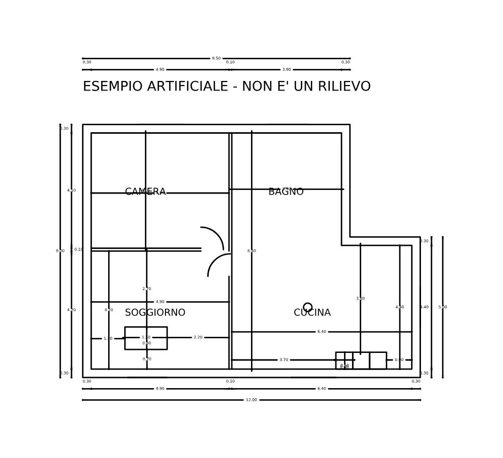

# DOMUS CAD — prototipo

Motore che trasforma una **planimetria CAD** in un nuovo elaborato: oggi una **pianta quotata** con catene di quote esterne, quote totali, **quote interne dei locali** (da muro a muro), nota e cartiglio, più rapporto dei controlli e anteprima. È la Fase 1 della [specifica](SPECIFICA.txt). Lo stato è in [ROADMAP.md](ROADMAP.md).



*Esempio artificiale (appartamento inventato). La prova su una pianta reale è in [prove/vivienda-moya-opcion2](prove/vivienda-moya-opcion2/).*

## Requisiti

- Python 3.10 o più recente (sul Mac: `python3 --version` nel Terminale).
- Le librerie in `requirements.txt` (ezdxf e Pillow, gratuite e open source).

## Prima installazione sul Mac

```bash
cd "/Users/andreagiacometti/Local Sites/DOMUS/cad"
python3 -m venv .venv
.venv/bin/pip install -r requirements.txt
```

## Uso

1. **Una volta per studio:** ricava il profilo dal file di riferimento dello studio, cioè un disegno già quotato a mano. DOMUS riconosce da solo:
   - il layer delle quote, cioè quello con più quote (per lo studio Pucci `01Cotas 1`);
   - lo stile di quota (`50`), con il suo stile di testo, e la scala;
   - i layer di muri, porte e finestre, arredi e limiti: dal nome in più lingue e, se il nome non basta, dalla geometria.
   ```bash
   .venv/bin/python -m domus_cad profilo riferimento.dxf --uscita profili/studio.json
   ```
   Il risultato è un file JSON leggibile, che si può correggere.
2. In AutoCAD apri la planimetria e fai *Salva con nome → DXF AutoCAD 2018*.
3. Genera la pianta quotata:
   ```bash
   .venv/bin/python -m domus_cad elabora pianta.dxf --uscita lavori/via-roma --progetto "Via Roma 12" --studio "Studio Pucci Architettura"
   ```
4. Apri `lavori/via-roma/elaborazioni/<data-ora>/elaborato.dxf` in AutoCAD, controllalo e salvalo come DWG.

Cosa viene quotato:
- **catene esterne** sui muri perimetrali, più le quote totali;
- **luci interne** da muro a muro in ogni locale, comprese le zone aperte come il garage, quotate così come sono disegnate;
- **distanze degli arredi** dai muri e tra loro;
- **misure degli arredi** (tavolo, modulo della cucina): **una sola quota** per misura e per locale, quindi moduli uguali da 60×60 hanno una quota sola.

Se due testi si toccherebbero, uno si sposta sopra o sotto la linea, oppure lungo la linea, anche fuori dalle estremità. La misura non cambia.

Le quote vanno **sul layer e con lo stile dello studio**:
- se il disegno li contiene già, vengono usati così come sono, senza modificarli;
- altrimenti vengono creati con le proprietà del profilo.

Su ogni quota resta solo la modifica che usa anche lo studio (es. DIMSCALE 1).

Opzioni utili (di solito non servono, perché vale il profilo):

| Opzione | Effetto |
|---|---|
| `--profilo FILE` | profilo dello studio (predefinito `profili/studio.json`) |
| `--unita m` / `cm` / `mm` | obbligatoria se il file non dichiara le unità |
| `--scala 50` | scala di stampa (predefinita: quella del profilo) |
| `--layer-muri …`, `--layer-arredi …`, `--layer-aperture …`, `--layer-limiti …` | forzano i ruoli dei layer |
| `--formato m` / `cm` / `mm` | unità del testo (predefinito: metri) |
| `--luce-minima 0.5`, `--luce-arredi 0.3` | misure minime da quotare, in metri |
| `--senza-interne` | solo le catene esterne |

## Test

```bash
.venv/bin/python -m unittest discover -s tests
```

Documenti: [ANALISI_TECNICA.md](ANALISI_TECNICA.md) · [ARCHITETTURA.md](ARCHITETTURA.md) · [TEST.md](TEST.md) · [LICENZE.md](LICENZE.md)
