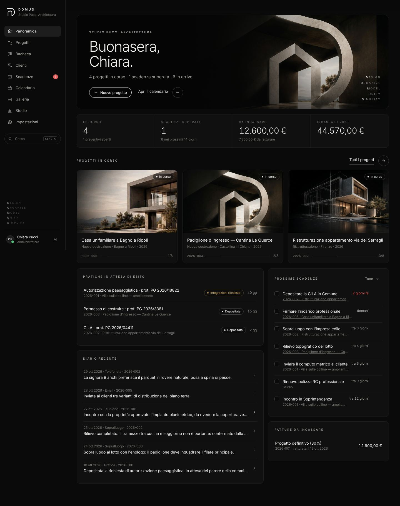
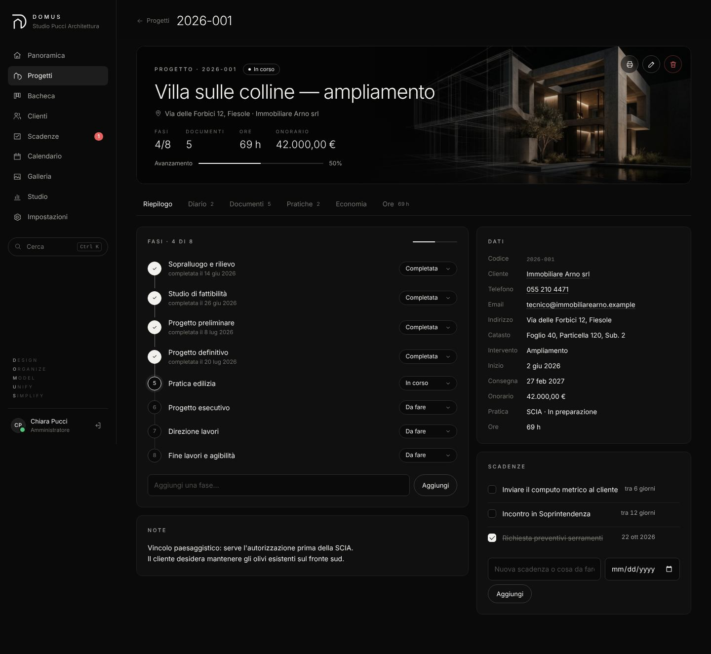
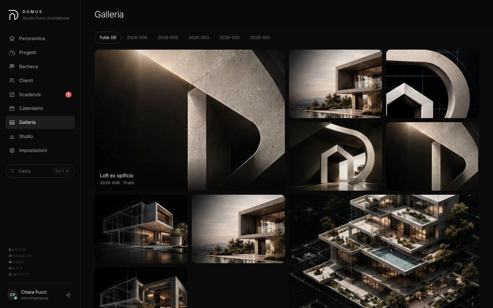
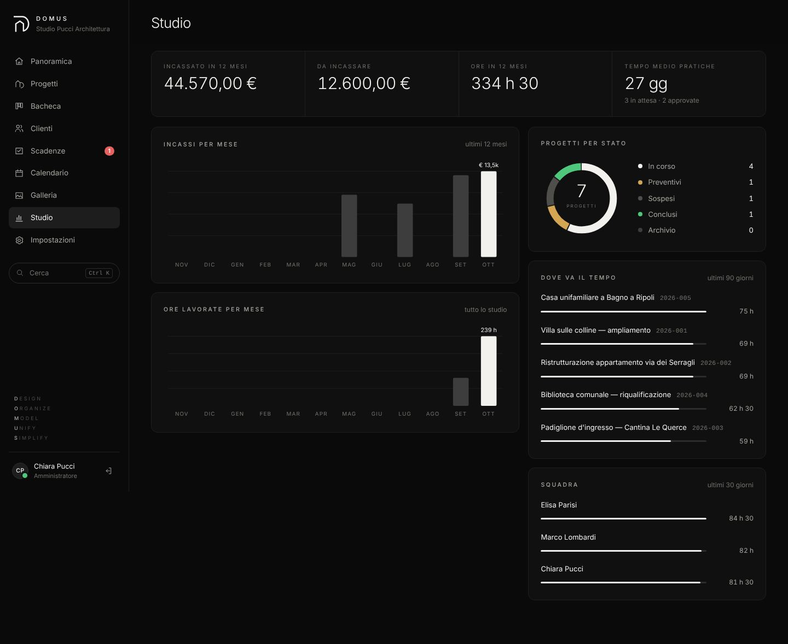
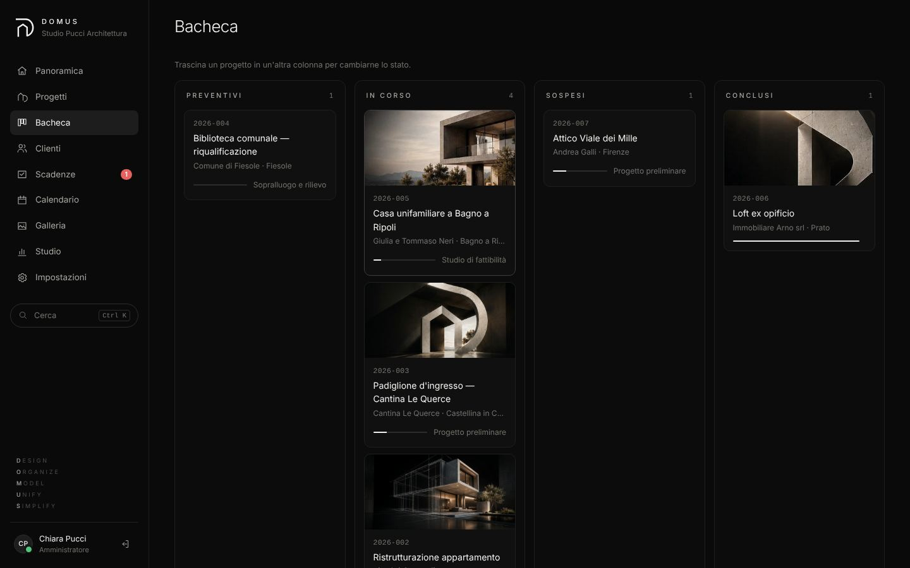
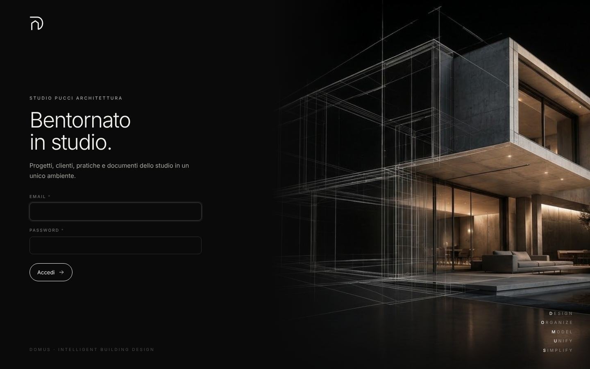

# DOMUS

Webapp per lo studio di architettura: **progetti** (commesse) con fasi, **clienti**, **scadenze**, **diario di commessa**, **documenti**, **pratiche edilizie**, **economia** (rate, fatture, incassi), **ore lavorate**, **calendario** e **collaboratori**.

- È un'applicazione PHP **autonoma**: non usa WordPress e non usa il database dell'hosting.
- I dati stanno in un **file SQLite** (`domus.sqlite`) nella cartella `domus-data`, fuori dalla parte pubblica del sito.
- Da *Impostazioni → Backup* si scarica tutto in un file **JSON** leggibile.

Lo stile (colori, caratteri, componenti, immagini) è descritto in [STILE.md](STILE.md). Le schermate sono in [docs/schermate](docs/schermate/).

| | |
|---|---|
|  |  |
|  |  |
|  |  |

## Requisiti

- PHP **8.1** o più recente, con l'estensione **pdo_sqlite** (inclusa in Local e quasi sempre negli hosting).
- Nient'altro: nessun database da creare, nessun pacchetto da installare.

## Installazione in Local

Il sito **DOMUS** creato con Local ha questa struttura:

```
Local Sites/DOMUS/
└── app/
    ├── public/            ← cartella pubblica del sito (WordPress)
    │   └── domus/         ← QUI va la cartella di DOMUS
    └── domus-data/        ← creata da sola al primo avvio: database (NON pubblica)
```

1. Copia la cartella `domus` dentro `Local Sites/DOMUS/app/public/`.
2. In Local avvia il sito (**Start site**).
3. Apri **http://domus.local/domus/** nel browser.
4. Al primo avvio crea l'account: nome dello studio, il tuo nome, email e password (almeno 10 caratteri).

## Uso

| Sezione | A cosa serve |
|---|---|
| **Panoramica** | progetti in corso, scadenze, pratiche in attesa di esito, fatture da incassare, diario recente |
| **Progetti** | elenco con ricerca e filtri per stato |
| **Planimetrie** | tutte le planimetrie esecutive in DXF (piante quotate, stato di fatto e di progetto, demolizioni e costruzioni, impianti), con quotatura automatica e ritocchi nel browser |
| **Scheda progetto** | sette schede: *Riepilogo* (fasi, dati, scadenze), *Diario*, *Documenti*, *Planimetrie*, *Pratiche*, *Economia*, *Ore*. Pulsante **Stampa** per la scheda su carta o PDF |
| **Clienti** | anagrafica (privati, aziende, enti) con i rispettivi progetti |
| **Scadenze** | tutte le cose da fare: superate, entro 7 giorni, fatte |
| **Calendario** | mese con scadenze, fasi, consegne, pratiche e rate (elenco sul telefono) |
| **Bacheca** | progetti in colonne per stato: si spostano trascinandoli |
| **Galleria** | tutte le foto dei progetti, con visore a tutto schermo (frecce della tastiera per scorrere) |
| **Studio** | statistiche: incassi e ore per mese, progetti per stato, dove va il tempo, ore della squadra, tempo medio delle pratiche |
| **Impostazioni** | nome dello studio, fasi standard, collaboratori, profilo e password, **profilo CAD dello studio**, calendario iCal, studio dimostrativo, backup JSON |

**Studio dimostrativo:** con l'archivio vuoto, dalla Panoramica o da Impostazioni si carica uno studio di esempio. Contiene 7 progetti, 6 clienti, 2 collaboratori, foto, documenti PDF, pratiche, rate e sei settimane di ore. Serve per provare tutte le funzioni.

**Preventivo PDF:** nella scheda *Economia* di un progetto, il pulsante **Preventivo PDF** genera la proposta di parcella. Contiene l'intestazione dello studio, il destinatario, le rate e il totale.

**Calendario sul Mac e sull'iPhone:** in *Impostazioni* c'è un indirizzo personale da abbonare nell'app Calendario (*Archivio → Nuovo abbonamento al calendario*). Scadenze, fasi, consegne, pratiche e rate si aggiornano da sole.

**Ricerca rapida:** `⌘K` (Mac) o `Ctrl K` da qualunque pagina cerca progetti, clienti, protocolli delle pratiche e nomi dei documenti.

**Documenti:** trascina i file nel riquadro o usa *Scegli file*. Sono ammessi PDF, immagini, DWG/DXF, IFC, SketchUp, documenti Office, ZIP e altri formati. Le foto si vedono in anteprima. I file stanno in `domus-data/files/` e si scaricano solo dopo l'accesso. La dimensione massima dipende dal PHP del sito (`upload_max_filesize` e `post_max_size`).

**Planimetrie** (schermate in `docs/schermate/f-*.png`):
- *Nuova planimetria*: scegli il progetto, il tipo e il DXF esportato da AutoCAD (*Salva con nome → DXF 2018*), oppure un DXF già nei Documenti.
- **Quota in automatico** crea una nuova versione con le quote di DOMUS:
  - catene esterne;
  - luci interne;
  - distanze degli arredi;
  - sul layer e con lo stile dello studio;
  - cartiglio compilato.
- **Ritocchi**:
  - clicca una quota e trascina la linea (la misura non cambia) o il numero (si sposta solo il testo), oppure eliminala;
  - clicca un testo per correggerlo;
  - i campi del cartiglio sono nel pannello a destra;
  - le modifiche restano in sospeso finché non premi **Salva nuova versione**.
- Ogni versione è anche un documento del progetto (categoria *Tavole*). L'elenco delle versioni mostra chi l'ha fatta, la nota e l'esito dei controlli (nessuna entità persa, misure invariate, file che si riapre).
- **Profilo CAD dello studio** (*Impostazioni*):
  - carica un disegno dello studio già quotato a mano;
  - DOMUS ricava da solo layer e stile delle quote, scala, layer di muri, porte, arredi e limiti;
  - senza profilo si usa quello dimostrativo (studio Pucci).
- Il motore CAD gira **nel browser** (Pyodide): niente Python sul server, va bene anche su un hosting condiviso.
  - La prima apertura scarica circa 15 MB da `cdn.jsdelivr.net`, poi restano nella cache del browser.
  - Serve la connessione a Internet.

**Ruoli:**
- l'**amministratore** vede tutto;
- i **collaboratori** vedono progetti, clienti, documenti, pratiche, scadenze e ore, ma non l'**economia**, le impostazioni dello studio e il backup;
- ogni collaboratore registra le proprie ore.

**Fasi:** cliccando il pallino, lo stato passa da *da fare* a *in corso* a *completata*. Il menu a tendina permette anche *non prevista*.

## Spostarlo su un hosting

Si copiano due cartelle: `domus` (nella parte pubblica) e `domus-data` (un livello sopra, fuori dalla parte pubblica). Se sull'hosting la struttura è diversa, indica il percorso dei dati in `config.php` (`data_dir`).

**Importante:** `domus-data` non deve mai stare dentro la cartella pubblica.

## Backup

- **Completo:** copia la cartella `domus-data` (database e documenti), con il sito fermo oppure subito dopo un salvataggio.
- **Leggibile:** *Impostazioni → Scarica backup JSON*.

## Test (per lo sviluppo)

```bash
bash tests/run.sh
```

Avvia DOMUS con il server PHP integrato su un database temporaneo e prova tutta l'API (118 controlli): accesso, ruoli, clienti, progetti, fasi, scadenze, diario, documenti, **planimetrie e versioni, profilo CAD**, pratiche, economia, ore, calendario, ricerca, backup, protezioni, studio dimostrativo, statistiche, galleria, iCal e preventivo PDF.

Il motore CAD dell'area Planimetrie ha i suoi test in `../cad` (`python -m unittest discover -s tests`). Dopo ogni modifica a `cad/domus_cad` va rilanciato `python ../cad/web/esporta_per_domus.py`, che aggiorna `assets/cad/motore.json`; un test lo controlla.
